 

<a href="#whoami"><b>whoami</b></a> &nbsp;·&nbsp;
<a href="#experience"><b>experience</b></a> &nbsp;·&nbsp;
<a href="#stack"><b>stack</b></a> &nbsp;·&nbsp;
<a href="#projects"><b>projects</b></a> &nbsp;·&nbsp;
<a href="#research"><b>research</b></a> &nbsp;·&nbsp;
<a href="#certifications"><b>certifications</b></a> &nbsp;·&nbsp;
<a href="#analytics"><b>analytics</b></a> &nbsp;·&nbsp;
<a href="#connect"><b>connect</b></a>

 

## `$ whoami`

  

 

I'm a **Computer Science engineer** who likes the part of the stack most people avoid: the servers, the logs, and the 2 AM "why is this down?" question.

I've worked hands-on with **SUSE Linux Enterprise Server**, **openSUSE** and **Ubuntu** — hardening hosts, automating config with **Ansible** and **SaltStack**, provisioning on **AWS**, and turning incidents into **RCA write-ups and runbooks** so the same problem doesn't come back.

> [!TIP]
> **Hiring for** Linux System Administrator · Linux / Technical Support Engineer · Infrastructure Support · Junior DevOps / SRE?
> I'm based in **Satna, MP, India** and open to on-site, hybrid or remote. → [**rajvl132011@gmail.com**](mailto:rajvl132011@gmail.com)

 

## `$ cat /var/log/experience`

<table width="100%">
  <tr>
    <td width="6%" align="center" valign="top">🟢</td>
    <td valign="top">
      <b>Trainee System Engineer Intern</b> · <b>OS3 Infotech Pvt. Ltd.</b> 
      Jan 2026 – Apr 2026 · 4 months · Navi Mumbai
        
      
      
      
      
      
      

        
<b>What I did</b>

         
        <ul>
          <li>Administered Linux servers backing internal business applications.</li>
          <li>Monitored, troubleshot and resolved incidents through log analysis, then documented root cause.</li>
          <li>Handled server configuration, package management and routine admin tasks.</li>
          <li>Wrote reusable <b>Bash scripts</b> and <b>Ansible playbooks</b> for configuration management.</li>
          <li>Applied security baselines: firewall rules, privilege restrictions and patching.</li>
          <li>Managed <b>Docker</b> environments for application testing and deployment.</li>
          <li>Maintained runbooks, troubleshooting guides and SOPs.</li>
        </ul>
      

    </td>
  </tr>
  <tr>
    <td width="6%" align="center" valign="top">🔵</td>
    <td valign="top">
      <b>Cloud &amp; DevOps Engineering Intern</b> · <b>Codenixia</b> 
      Sep 2025 – Dec 2025 · 4 months · Remote
        
      
      
      
      
      

        
<b>What I did</b>

         
        <ul>
          <li>Provisioned and managed AWS compute (EC2), networking (VPC, subnets, security groups) and storage (S3).</li>
          <li>Built CI/CD pipelines to automate build and release.</li>
          <li>Administered Linux instances: services, networking and performance tuning.</li>
          <li>Delivered hands-on cloud projects using Git workflows and automation scripts.</li>
        </ul>
      

    </td>
  </tr>
</table>

 

## `$ ls ~/stack`

<table width="100%">
  <tr>
    <td width="22%"><b>🐧 OS &amp; Shell</b></td>
    <td>
      
      &nbsp;
      
      
    </td>
  </tr>
  <tr>
    <td><b>⚙️ Automation</b></td>
    <td>
      
      &nbsp;
      
    </td>
  </tr>
  <tr>
    <td><b>☁️ Cloud &amp; Containers</b></td>
    <td></td>
  </tr>
  <tr>
    <td><b>🚀 CI/CD &amp; VCS</b></td>
    <td></td>
  </tr>
  <tr>
    <td><b>🛠️ Ops practice</b></td>
    <td>
      <code>systemd</code> <code>journalctl</code> <code>dmesg</code> <code>firewalld / ufw</code> <code>ssh hardening</code> <code>auditd</code>
      <code>log analysis</code> <code>RCA</code> <code>runbooks / SOPs</code>
    </td>
  </tr>
</table>

 

## `$ ls ~/projects`

<table width="100%">
  <tr>
    <td width="50%" valign="top">
      <h4>🛡️ Linux Server Hardening</h4>
      <code>Ansible</code> <code>Bash</code> <code>SLES</code>
      
Idempotent playbooks that apply a CIS-aligned baseline across a multi-node fleet.

      <ul>
        <li>Firewall policy (firewalld / ufw) + SSH lockdown</li>
        <li>Password policy, privilege limits, <code>auditd</code> rules</li>
        <li>One-command, re-runnable rollout</li>
      </ul>
    </td>
    <td width="50%" valign="top">
      <h4>🔍 Monitoring &amp; Incident RCA</h4>
      <code>Bash</code> <code>systemd</code> <code>Log analysis</code>
      
A practice framework for simulated incidents: detect → diagnose → write it up.

      <ul>
        <li><code>journalctl</code>, kernel log and <code>dmesg</code> triage flow</li>
        <li>CPU / memory / disk threshold alert scripts</li>
        <li>RCA + post-mortem templates, preventive runbooks</li>
      </ul>
    </td>
  </tr>
  <tr>
    <td width="50%" valign="top">
      <h4>☁️ AWS Network &amp; Compute Lab</h4>
      <code>EC2</code> <code>VPC</code> <code>S3</code> <code>IAM</code>
      
A secure baseline AWS environment built from scratch.

      <ul>
        <li>Custom VPC with public / private subnets and route tables</li>
        <li>Least-privilege security groups and IAM roles</li>
        <li>Shell bootstrap for web-server hosting</li>
      </ul>
    </td>
    <td width="50%" valign="top">
      <h4>🐳 Docker + GitHub Actions Pipeline</h4>
      <code>Docker</code> <code>GitHub Actions</code> <code>YAML</code>
      
Build → lint → containerise → deploy, on every push.

      <ul>
        <li>Multi-stage Dockerfiles for smaller, leaner images</li>
        <li>Automated build and lint checks</li>
        <li>Repeatable, standardised deploy flow</li>
      </ul>
    </td>
  </tr>
</table>

  

 

<b>🌐 Open source — Ether Chess OTC</b> (click to expand)

 

  
   
  

 

## `$ cat ~/research.md`

<table width="100%">
  <tr>
    <td width="68%" valign="top">
      <b>Deep learning for biometric security</b> — 2 research items 
      Co-authored work on presentation-attack detection (anti-spoofing) and the robustness of face-recognition models. I evaluated model behaviour against physical spoofing attacks and built data-validation pipelines in Python.
        
      
    </td>
    <td width="32%" align="center" valign="middle">
       
       
       
      
    </td>
  </tr>
</table>

 

## `$ ls ~/certifications`

<table width="100%">
  <tr>
    <td width="50%" valign="top">
      <b>🐧 Systems &amp; DevOps</b>
      <ul>
        <li><b>OS3 Infotech</b> — Trainee Systems Engineer</li>
        <li><b>Codenixia CX-501</b> — Linux Administration</li>
        <li><b>Codenixia CX-701</b> — Linux Server Hardening &amp; Security</li>
        <li><b>Anthropic</b> — Claude Code in Action</li>
      </ul>
    </td>
    <td width="50%" valign="top">
      <b>📜 Industry &amp; Government</b>
      <ul>
        <li><b>NCVET</b> — Junior Software Developer</li>
        <li><b>Skill India</b> — Junior Software Developer (MERN)</li>
        <li><b>Goldman Sachs</b> — Software Engineering Job Simulation</li>
        <li><b>Goldman Sachs</b> — Security Assessment &amp; Vulnerability Analysis</li>
      </ul>
    </td>
  </tr>
  <tr>
    <td colspan="2" align="center">
      🏆 <b>Finalist</b> — Hackverse 5.0 &nbsp;·&nbsp; Thrilex 2024
      &nbsp;&nbsp;|&nbsp;&nbsp;
      🎓 <b>B.Tech CSE</b>, AKS University, Satna (2022 – 2026)
    </td>
  </tr>
</table>

 

## `$ gh stats`

  

  

<picture>
  <source media="(prefers-color-scheme: dark)" srcset="https://raw.githubusercontent.com/Navneet1206/Navneet1206/output/snake-dark.svg" />
  
</picture>

 

## `$ ssh navneet@hire-me`

**Building a Linux, DevOps or SRE team? Let's talk.**

  

<i>"Discipline, consistency and hands-on practice build real engineering capability."</i>

